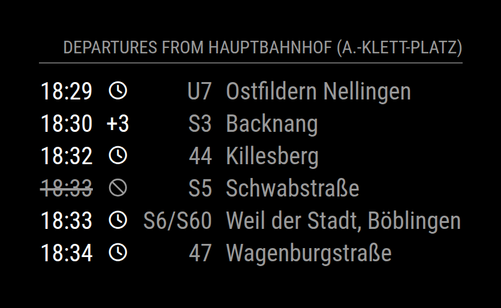

# MMM-vvsDeparture

A [MagicMirror²](https://magicmirror.builders) module that shows the next departures from a stop of the [VVS](https://www.vvs.de), the public transport network of the Stuttgart region, with realtime delays and cancellations.



## Features

- The next departures with their planned time, line and destination, straight from VVS, without an API key
- Delays and early departures in minutes, e.g. `+3` or `-1`, a clock for departures on time, and a ban sign and a struck-through time for cancelled ones. Without realtime data, the column stays empty.
- Coupled trains in one row, e.g. `S6/S60`, with all destinations of a train that splits later on
- Filters for lines and destinations, and an offset for the time you need to get to the stop
- English and German

## Installation

The module requires MagicMirror² 2.25.0 or newer. There is nothing to install with npm. Clone it into the `modules` directory of MagicMirror²:

```shell
cd ~/MagicMirror/modules
git clone https://github.com/ms-zone-41/MMM-vvsDeparture
```

Add it to your configuration, see below, and restart MagicMirror².

## Update

```shell
cd ~/MagicMirror/modules/MMM-vvsDeparture
git pull
```

Then restart MagicMirror². If you have the module from [fhinder/MMM-vvsDeparture](https://github.com/fhinder/MMM-vvsDeparture), delete the directory `~/MagicMirror/modules/MMM-vvsDeparture` instead and install the module again, see [Installation](#installation). Your configuration keeps working, but the realtime status is only red and green if you set `colorDelay` and `colorNoDelay` to `true`.

## Configuration

Add the module to the `modules` array in `config/config.js`, with the ID of your stop:

```js
	{
		module: "MMM-vvsDeparture",
		position: "top_right",
		config: {
			station_id: "de:08118:7000" // Ditzingen
		}
	},
```

### Finding the ID of your stop

Open this address in a browser, with the name of your stop in place of `Ditzingen%20Bahnhof`:

<https://www3.vvs.de/mngvvs/XML_STOPFINDER_REQUEST?outputFormat=rapidJSON&type_sf=any&anyObjFilter_sf=2&name_sf=Ditzingen%20Bahnhof>

VVS answers with the stops that match the name. Copy the `id` of your stop, e.g. `de:08118:7000` for Ditzingen, Bahnhof.

### Options

| Option | Description | Default |
| --- | --- | --- |
| `station_id` | The ID of the stop, not its name. | `"de:08111:6112"`: Hauptbahnhof (A.-Klett-Platz) in Stuttgart |
| `station_name` | The name of the stop in the header. | The name from VVS |
| `maximumEntries` | The maximum number of departures to show. A coupled train counts once. | `6` |
| `reloadInterval` | How often to load the departures, in milliseconds, at least `30000`. | `60000` (one minute) |
| `colorDelay` | Show delays, early departures and the ban sign in red. | `false` |
| `colorNoDelay` | Show the clock of departures on time in green. | `false` |
| `number` | Only show these lines: one line, e.g. `"S6"` or `622`, a list, e.g. `["S6", "S60"]`, or a function that returns `true` for the lines to show. | All lines |
| `direction` | Only show departures to these destinations: one destination, e.g. `"Schwabstraße"`, a list, or a function, e.g. `(destination) => destination !== "Weil der Stadt"`. | All destinations |
| `offset` | Only show departures in at least this many minutes, e.g. the time you need to get to the stop. | None |

`number` and `direction` compare each line and destination as the module spells it, e.g. `"Schwabstraße"`, not `"Schwabstrasse"`, and `"S6"`, not `"S6/S60"`. Functions do not work with MagicMirror² 2.35.

The module loads the next 100 departures of the stop and then filters them. At a busy stop they cover only about half an hour, so the filters can leave fewer departures than `maximumEntries`.

The header names the stop. The `header` option of MagicMirror² replaces it, see the example, and `header: ""` hides it. For several stops, add the module once for each.

### Example

The departures from Ditzingen to Schwabstraße that you can still catch if you need five minutes to get to the stop, under a header of your own:

```js
	{
		module: "MMM-vvsDeparture",
		position: "top_left",
		header: "To Stuttgart",
		config: {
			station_id: "de:08118:7000", // Ditzingen
			direction: "Schwabstraße",
			offset: 5
		}
	},
```

## Messages

Instead of the departures, the module can show a message:

- **No stop with the ID “…”**: `station_id` is not the ID of a VVS stop, e.g. a name. See [Finding the ID of your stop](#finding-the-id-of-your-stop).
- **No departures**: none of the next 100 departures matches `number` and `direction`, or VVS lists none.
- **Could not load the departures from VVS**: the request to VVS failed. Below the message, the module shows why, e.g. `getaddrinfo EAI_AGAIN www3.vvs.de` if the mirror is offline, or `HTTP 503` if VVS has a problem. The module tries again at the next update.

## Development

The tests use [node:test](https://nodejs.org/api/test.html) and the development dependencies of the module. Run them and [ESLint](https://eslint.org) in the module directory:

```shell
npm install
node --run test
node --run lint
```

GitHub runs both for every push and pull request.

## Changelog

See [CHANGELOG.md](CHANGELOG.md).

## License

MIT, see [LICENSE](LICENSE). [Niklas Kappler](https://github.com/niklaskappler/MMM-vvsDeparture) wrote the module. [Fabian Hinder](https://github.com/fhinder/MMM-vvsDeparture) maintained a fork of it, which this one continues.
